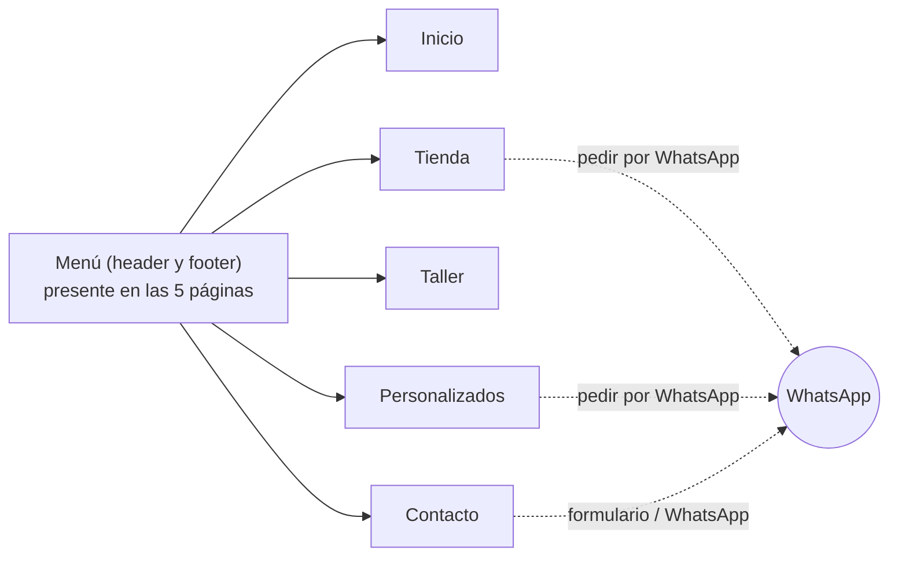

# ViLu · PEC 04 · Maqueta HTML + CSS

Maqueta web de **ViLu**, un pequeño negocio Colombo-sevillano de pulseras, madera pintada y chocolates hechos a mano.

- **Diseño de referencia (Figma):** https://www.figma.com/design/UUvqklo233TfwOTHh3o7bu/LuVi---Bisuteria-y-Moda-Infantil
- **Tecnologías:** HTML5 semántico y CSS (un único archivo, `css/main.css`). Sin frameworks. JavaScript pendiente para la PEC 5.
- **Metodología CSS:** BEM.
- **Sitio publicado:** https://tiendas-vilu.creatuapp.es/

## Páginas que he maquetado

He hecho las 5 páginas del sitio:

- **Inicio** (`index.html`)
- **Tienda** (`tienda.html`)
- **Taller** (`taller.html`)
- **Personalizados** (`personalizados.html`)
- **Contacto** (`contacto.html`)

## Componentes que he creado

Son piezas que se repiten en varias páginas, hechas con clases CSS reutilizables (así no repito código):

- Header y footer
- Botones (primario, secundario y claro)
- Card de producto
- Card de categoría
- Tarjeta de testimonio (opiniones)
- Paso del proceso (los pasos numerados de "cómo trabajamos")
- Beneficio (los iconos con texto corto, tipo "envíos gratis")
- Banner de personalizados (el aviso que invita a pedir algo a medida)
- Cabecera de página (el título y texto de arriba en cada página interior)
- Chip de filtro (en la Tienda)
- Pregunta frecuente / acordeón (en Contacto)

## Cambios que he hecho respecto al diseño de Figma

El diseño de Figma no lo seguí al 100 %, tuve que tomar algunas decisiones por mi cuenta:

- **Personalizados no tenía diseño en Figma.** No existe esa página en el archivo, así que la armé yo reutilizando componentes de otras páginas (cabecera, categorías, pasos del proceso y el banner), y lo dejé anotado en el propio HTML con un comentario.
- **Iconos de "beneficios" en Tienda.** En el diseño había un icono de corazón y uno de WhatsApp que no encajaban con el texto, así que los cambié por un icono de regalo y uno de pago.
- **Iconos nuevos en Contacto.** Dibujé a mano (SVG) los iconos de correo, ubicación y reloj para las tarjetas de contacto, siguiendo el mismo estilo que ya tenía el icono de envío.
- **Catálogo de Tienda y galería de Taller.** En el diseño las tarjetas no decían cómo se acomodan al crecer el catálogo. Usé una cuadrícula (CSS Grid) que las reparte en filas y se adapta sola en móvil, en vez de que se salieran de la pantalla.
- **Preguntas frecuentes.** Las hice con `
`/`
`, que es HTML nativo y abre/cierra sin necesitar JavaScript. Dejé el símbolo "+" fijo (sin que cambie a "−" al abrir) porque ese detalle lo voy a resolver con JavaScript en la PEC 5.

## Diagrama de páginas y navegación

Las 5 páginas están conectadas entre sí por el mismo menú de navegación (arriba y en el footer), así que desde cualquiera se puede ir a cualquier otra. Además, desde Tienda, Personalizados y Contacto hay enlaces directos a WhatsApp para hacer el pedido.
